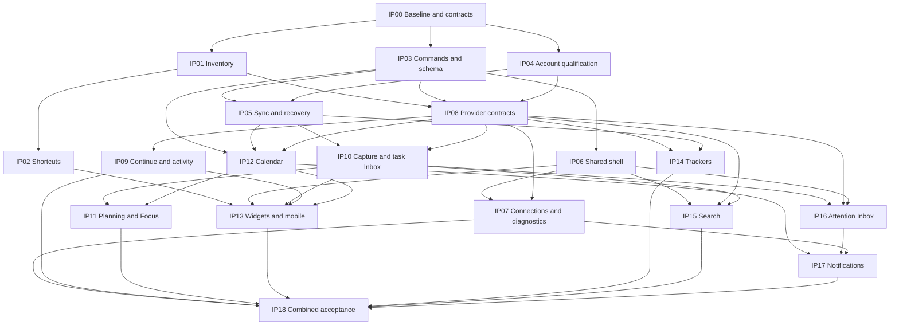

# Connected Hub implementation plan

Status: ready to execute. Prepared 15 October 2026. Scope: all 32 findings in [the audited program](connected-hub-program.md). This document defines implementation work; it does not claim that these changes have shipped.

## 1. Starting point and delivery model

- Preserve current main `e0f64a41b519710136477511144de44f0fcfe3c4` and its working adaptive workspace, Home/Apps parity, four-item mobile navigation and smooth core routing.
- Reuse Hub account/sync PR #154 at `a44e04daf4278eddd10b15851ad5d4311c575c0d` and Account PR #83 at `762fed84f3887939491e7e67d372109cd06e27a6`; neither is merged at plan time. Recheck both heads before work starts.
- Latest Hub PR results: **Quality passed**; the Library `staged-paired` suite failed at “Device consent and actual owner projection in all engines.” Its log reports `[data-private-library]` hidden where a test expects it visible. Root cause is not yet established. Reproduce and reconcile current modal/privacy/identity behavior with the fixture; preserve the security assertions rather than disabling the suite.
- Account CI is separately blocked before execution by GitHub payments/spending limits. Restore the required execution capacity, then use its existing protected release workflow. Local passing tests do not replace required main-commit evidence.
- Use one integration branch, `feat/connected-hub`, and small dependency-ordered change sets. Keep each change set reviewable and record its exact parent. Do not create another chain of feature branches that never reaches the integration branch.
- Three implementation lanes can progress after shared contracts are settled: **inventory/UX**, **account/data**, and **daily workflows**. This describes work organization; no additional agents or resources are assumed to exist.
- Produce one coherent product milestone with explicit release checkpoints: current apps first; reliable account/sync; useful daily workflow; deeper native connections. Every shipped checkpoint must be usable independently and compatible with the next one.

## 2. Contracts to settle before feature expansion

### Launch inventory

Create a reviewed Core `registry/launches.v1.json` and schema alongside `registry/products.v2.json`. This launch inventory contains product modules **and** approved standalone legacy apps, including apps not yet assigned to a family. Do not replace 27 older entries with only the smaller set of currently modeled product modules.

A launch record contains: stable launch ID; optional canonical product/module reference; legacy aliases; display name/icon/category; owner repo; approved/listed state; platform/distribution; launch availability; exact canonical URL; supported action identifiers; capability-contract references. A module’s active state is evaluated independently of its staged parent. Assigned URLs on staged modules remain staged.

Generate and commit a sanitized Hub `src/generated/launch-manifest.json` with source commit, content hash and schema version. Builds use this reviewed snapshot without fetching live mutable registry data. A read-only drift check proposes additions/changes/retirements for review. Capability claims require their own verified contract; descriptive registry strings are not proof of working sync.

Examples needing explicit mapping include `thiepn-library → folio/library`, `tiny-tools → hub/tools`, `pdf-studio → pdf/studio` and `biblical-greek → bible/greek`. Confirm identity-equivalence before adding an alias; do not infer that two language apps share native data. An unresolved legacy app remains a usable reviewed standalone destination until reconciliation is complete.

### Workspace data and commands

Keep `WorkspaceStore` as the persistence boundary. Introduce typed commands and selectors before adding new write paths. All Hub UI surfaces call commands; native commands use a separate owner-authorized transport and receipt.

Schema v2 must cover optional task scheduling/source references, recurrence definitions/exceptions, source descriptors, notification preferences and related resource references. Define the exact shapes in `types.ts` and JSON schemas before implementing features. Retain existing entity IDs and unknown recoverable data. A versioned export envelope includes schema/writer versions and source provenance without copying arbitrary native private bodies.

Deploy server readers/validators before v2 writers. Migrate each owner namespace transactionally, increment the revision and keep a recovery snapshot. An old writer must be rejected when it cannot preserve the current document’s fields. Do not relabel guest data as account data. After v2 activation, the rollback target must remain v2-readable; do not downgrade stored documents automatically.

### Provider/runtime contract

Every provider declares independently supported `summary`, `search`, `resume`, `attention` and command operations. Every private result carries owner, provider, resource identity, source revision, observation/source timestamps, expiry, capability/grant context and status. Store bounded projection caches separately from authoritative Hub records; clear them on owner change, privacy masking, revocation or expiry.

Begin with at most three concurrent provider reads, per-operation deadlines and existing reviewed payload limits. Local results render before network results. Timeout/error/unconnected/stale/empty remain distinct. Native apps validate identities, permissions, deep links and command receipts on their own boundary.

## 3. Change sets

Each package below is a reviewable implementation unit. Existing files are listed plainly; proposed new files are marked **new**. The [companion JSON backlog](connected-hub-backlog.json) records dependencies, repository/file targets, coverage and completion gates.

### IP00 — Baseline, contracts and branch reconciliation

**Depends:** none. **Covers:** H1, H2, H3.

- Record exact main, Core snapshot, account/sync and draft heads in **new** `docs/workspace/connected-hub-release.json`.
- Review actual incremental diffs from #142–153 against their stated parents. Map behavior to current commands/models; mark each slice reuse/adapt/replace/defer with reasons. Preserve current main’s navigation fixes.
- Reproduce the Library paired-suite failure and specify the correct visible/modal/identity/consent behavior. Fix product or fixture according to that contract; keep revocation, expiry and owner-return assertions intact.
- Freeze launch, v2 workspace, provider and command contracts with representative fixtures. Identify any app contract that must be built by its owning repository.
- **Exit:** approved schemas/fixtures, branch extraction map, truthful CI ledger and reproducible release blockers. No blanket merge of the draft stack.

### IP01 — Canonical inventory and compatibility resolver

**Depends:** IP00. **Covers:** A1, A2.

- Core: **new** `registry/launches.v1.json`, its schema and drift/consistency checks. Reconcile all 27 legacy entries, four deliberate exclusions and newer active destinations such as Diet, Recipe, Bikes and Orrery.
- Hub: adapt `src/lib/product-registry.ts`, `src/lib/hub.ts`, `src/types/product-registry.ts`; add **new** `src/lib/launches/{types,resolver}.ts` and `scripts/sync-launch-manifest.mjs`.
- Generate Apps, shortcut options, action discovery and public search from the same launch projection. Adapt `src/pages/{apps,search}/`, `HubCatalogue.astro`, `HubFilters.astro` and release-count checks to derived reviewed counts.
- Preserve legacy URLs and pin references. Detect duplicate IDs/aliases, ambiguous targets, redirect loops, unavailable destinations and unsupported platforms. Supply old-to-new lookup without silently rewriting ambiguous records.
- **Tests:** registry fixtures with standalone apps, staged parents/active modules, retired apps, duplicate aliases and missing URLs; browser test new destination → Apps → pin chooser → search → correct launch. Existing legacy roster remains accounted for.

### IP02 — Practical shortcut management

**Depends:** IP01; persistence changes use IP03. **Covers:** A3, A4, E2.

- Add **new** `src/components/workspace/ShortcutEditor.astro`, `src/scripts/workspace-shortcuts.ts`, and shortcut commands/selectors. Adapt workspace renderer and Apps pin controls.
- Separate shortcut contents/order from layout geometry. Provide Pinned, Recent and Connected lists; retain search. Offer optional explainable suggestions without rearranging manual pins.
- Add user-defined HTTPS launch-only links with stable IDs and a separate external designation. Reject executable URLs and embedded credentials; keep private bookmarks out of public indexes/analytics.
- Keep existing order and manual choices. Show a repairable unavailable shortcut instead of dropping it. Local recent-use history can be cleared and disabled.
- **Tests:** pin/unpin from Apps, keyboard/touch reorder, alias upgrade, search new apps, retirement, safe external links and persistence across devices. Opening/canceling simple pin editing creates no layout-recovery draft.

### IP03 — Command boundary, selectors and safe schema expansion

**Depends:** IP00. **Covers:** G1, G2.

- Extract **new** `src/lib/workspace/{commands,selectors,migrations,export}.ts`; split rendering/routing/editor responsibilities into small controllers while retaining one store writer.
- Update `types.ts`, `model.ts`, `store.ts` and schemas; preserve task IDs, layout IDs, drafts, backups, references and unknown supported fields. Add a compatibility/write-version check to cloud operations in Account.
- Implement transactional namespace migration and import preview. Keep native resource caches separate. Enforce current 5 MB document budget with visible recovery/export behavior; benchmark realistic large documents before deciding on incremental storage/sync.
- **Tests:** v1 → v2 local/cloud/export migration, repeat migration, interrupted write, unknown newer version, stale writers, duplicate IDs and field preservation. Existing navigation/local workspace behavioral tests remain green throughout extraction.

### IP04 — Qualify account connection and app session adoption

**Depends:** IP00; native app adoption follows IP01 identities. **Covers:** B1, B3.

- Reconcile and qualify existing Hub #154 + Account #83; restore required private CI capacity. Reuse the registered Hub client rather than registering duplicates.
- Update Account sharing/connection routes and the Hub account controller/callback only where required by the verified contract.
- Inventory native app auth paths. Integrate the shared Account session SDK per app where supported, with separate app tokens, exact callback, safe return path, refresh, deliberate local sign-out and current-session/grant checks.
- Introduce shared brand/navigation/theme primitives incrementally across different app frameworks. Preserve native task-specific layouts; do not embed every app in Hub or copy tokens between apps.
- **Tests:** synthetic SDK flows plus separately authorized real Google/Account sign-in, refresh, two devices, reconnect, explicit opt-out and cross-tab/account switching. A feature is not marked verified based only on public CI.

### IP05 — Durable sync, recovery and lifecycle completion

**Depends:** IP03, IP04. **Covers:** B4, G3.

- Extend `cloud-sync.ts`, `sync-merge.ts`, `WorkspaceStore` and Account migrations through versioned migrations/RPC changes. Retain durable immutable commands, CAS and owner-bound server checks.
- Finish conflict review/export of both versions, restore previews, retry controls and mobile access. Specify receipt/history retention and quota behavior; expired receipts must never turn retries into duplicate writes, and deleted account documents must not silently resurrect.
- Define export, disconnect, app-data removal and full-account deletion behavior, including local retained copies. Document actionable pending/synced/paused/conflict states.
- **Tests:** lost ACK, concurrent edits/deletes, old pending commands, document removal, quota/retention, account switch during save, browser close/offline and schema rollback. Verify native app data stays in native stores.

### IP06 — One Hub shell and navigation lifecycle

**Depends:** IP03; can develop alongside IP04–05. **Covers:** E1.

- Extend `WorkspaceShell.astro` and shared styles/controllers to `/search/`, `/inbox/`, `/home/connections/` and Hub workflow surfaces. Preserve valid old URLs and deep links.
- Use one theme, spacing system, dialogs, control states and route/focus policy. Extract Hub UI primitives rather than adding another framework.
- Preserve the trusted `/home/` device-reading host and its required full-document boundaries. Keep the existing smooth core SPA-style transitions, browser history and drafts.
- **Tests:** navigate through every Hub route, back/forward, keyboard focus, privacy and reduced motion. Assert one shell and no duplicate search/auth/controller mounts; verify the reading-host security boundary separately.

### IP07 — Connection center and safe diagnostics

**Depends:** IP04, IP06; provider status supplied by IP08. **Covers:** B2, G4.

- Add **new** connection-state selectors and connection-center components. Show account, launch/read/resume/write capabilities, consent scope, last successful sync and specific repair actions for each app.
- Replace implementation-gate copy with useful user language. Preserve native Account as the authority for permission decisions.
- Add redacted diagnostic export: client/release/schema versions, source status and safe error codes. Exclude tokens, private queries and resource bodies.
- **Tests:** disconnected, expired, forbidden, stale, offline and unsupported states; permission revocation while open; safe redaction and mobile connection/recovery access.

### IP08 — Provider runtime and complete app capability matrix

**Depends:** IP01, IP03, IP04. **Covers:** C1, C3.

- Consolidate `src/lib/providers/`, `hub-providers.json` and `hub-connected-apps.ts` behind **new** provider registry/runtime interfaces. Adopt the contract from section 2.
- Build a row per launch destination: current owner, account/read/resume/attention/command support, evidence, freshness budget, endpoint/SDK, consent and implementation task. Keep launch-only destinations usable.
- Initial adapters: Notes, Library and TMS60. Then Diet, Recipe, active Languages modules and Bikes according to verified owner APIs. Account/Core gateways remain separately authorized boundaries.
- Open bounded owner-repo changes for missing contracts. Folio/Bible/Study staged surfaces, Finance and any unsupported module remain explicitly staged until their owner release is qualified.
- **Tests:** stale/out-of-order/malformed/foreign-owner results, parallel budgets, cancellation, one failing source, revocation and cache clearing. No fabricated zero states.

### IP09 — Genuine continuation and cross-app activity

**Depends:** IP08, IP06. **Covers:** C2, C5.

- Reconcile #144 with the selected provider runtime; add **new** typed `ResourceRef`, resume resolver and activity selectors.
- Resume an exact owned note, correct Library edition/location or TMS60 translation/context using app-supported contracts. Generic app opening remains an explicitly labeled fallback.
- Merge bounded native activity with Hub activity using source/event IDs, timestamps and source controls. Preserve Hub navigation/selected work when returning.
- **Tests:** native change → visible authorized metadata → exact resource → return; moved/deleted resource, revoked access, stale snapshots, deduplication and privacy masking.

### IP10 — Unified capture and consistent task Inbox

**Depends:** IP03, IP05, IP08 for native destinations. **Covers:** C4, D1.

- Reuse #145’s useful capture/task-flow slices behind typed commands. Share Inbox/Today/Upcoming/overdue selectors across planner, task pages, widgets and search.
- Make capture destination explicit: Hub task, Hub note, or an actually supported native destination. Retain draft and show durable receipt/pending/error feedback for native commands.
- Keep creating a native note and creating a Hub note distinguishable. Show pending command recovery without accidental double submission.
- **Tests:** unscheduled/overdue/date-only/completed tasks, consistent counts, offline draft, destination revocation, timeout/lost receipt, retry and undo.

### IP11 — Scheduling, Focus and reviewed follow-through

**Depends:** IP10 and IP12’s shared scheduling types. **Covers:** D2, D4.

- Adapt #148 and #150–153 through one command model: task-to-block relationship, schedule/reschedule/unschedule, choose next task, Focus and explicit defer/carry-forward review.
- Define which action updates the task and which updates an owned calendar block. Completing a task never deletes an unrelated native event.
- Use the same records/selectors in Today, Focus and Week. Keep layouts configurable rather than adding several duplicate dashboards.
- **Tests:** one captured task through all views, repeated schedule commands, edit from two views, undo, week/timezone boundary and carry-forward preview/cancel/confirm.

### IP12 — Native calendar and external read-only coverage

**Depends:** IP03, IP05; source status integrates with IP08. **Covers:** D3.

- Introduce **new** calendar/recurrence selectors and commands; adapt calendar page/planner. Implement day/week views, all-day/timed events, recurrence exceptions and DST-safe editing.
- Review #143’s bounded browser ICS parser. Validate sizes, event limits, unsupported RRULE/timezones, source replacement and duplicate imports. Keep imported snapshots labeled read-only with observation/source timestamps.
- Add authenticated read-only calendar adapters only after a real owner-supported contract is identified and qualified; define explicit permission scopes, refresh/revocation and token handling. Calendar writes are a separate authorized command capability.
- **Tests:** DST gaps/folds, locale/timezone changes, recurrence edits/exceptions, bad/oversized ICS, duplicate sources, stale snapshot and native-vs-imported ownership.

### IP13 — Useful widgets, approachable layout editing and mobile Today

**Depends:** IP02, IP06, IP10; calendar/continuation feed in as available. **Covers:** E3, E4.

- Assess #142/#146: Task Inbox, Priorities, Upcoming, Recent Captures, Quick Planning and Connected Apps widgets. Implement them through the original widget registry, shared selectors and writer.
- Offer compact/list/detail views, visual size presets and optional advanced coordinates. Preserve keyboard move/resize, undo and named workspaces. Shortcuts edit independently.
- Auto-size empty/new-user widgets without moving a customized layout unexpectedly. Add a concise useful setup path and an accessible mobile Today/agenda sheet; retain four-item mobile navigation and the desktop planner.
- **Tests:** unknown/new widgets, responsive projections, empty/populated/dense states, 320px and large text, drag/keyboard/touch editing, focus restoration and persistence through layout changes.

### IP14 — Tracking, habits and source-backed progress

**Depends:** IP03, IP05, IP08. **Covers:** D5.

- Extend tracker commands/selectors for habits, editable goals, streaks and source attribution. Manual logs remain available offline.
- Bind optional app-derived measurements to a real metric/event contract. Define units, cadence, timezone/day boundaries and corrections. Prevent duplicate imported logs using provider/event identity.
- **Tests:** repeated event, offline replay, manual override, goal changes, missed days, timezone boundaries and export/restore. Surface manual/imported distinctions.

### IP15 — One search and action palette

**Depends:** IP01, IP03, IP06, IP08; native commands require IP10. **Covers:** F1.

- Adapt #147 into **new** pure search index/ranking and action registry modules. Unify header/public work search across app names/aliases, tasks, notes, events, trackers and commands.
- Render local results immediately. Fetch bounded authorized resource results only when opted in, with cancellation and explicit source/freshness. Share one keyboard/focus/result model.
- Keep private queries out of URLs, public search indexes, analytics and diagnostics.
- **Tests:** new/renamed app, filtered groups, no results, keyboard actions, stale/late remote reply, revoked scope, offline local results and correct record/action destination.

### IP16 — Attention Inbox with real outcomes

**Depends:** IP06, IP08, IP10. **Covers:** F2.

- Reuse valid existing attention/inbox contracts. Build native-source issue records with owner/source IDs, explicit status and supported resolution commands.
- Group/deduplicate real reminders, failed jobs and conflicts. Offer dismiss/snooze/resolve only when supported, with command receipts and correct native read-back.
- **Tests:** none/unconnected/stale/error distinctions, duplicate events, concurrent resolution, snooze expiry, revoked scope and failure recovery. Reading an item does not silently resolve it.

### IP17 — Reminder delivery policy and optional notifications

**Depends:** IP12, IP16, IP07. **Covers:** F3.

- Implement in-app due/reminder state and user notification preferences, quiet hours and timezone semantics first.
- Add permission-requested browser notifications where supported. Mark background delivery unsupported until an explicitly selected backend, push subscription lifecycle and scheduler/retry contract have been implemented and tested.
- **Tests:** permission denied, quiet hours, clock/timezone changes, duplicate delivery, expired subscriptions and offline/inactive-page limitations. No claim of background delivery from a closed static page.

### IP18 — Combined acceptance, release and operational handoff

**Depends:** all preceding packages. **Covers:** H2, H3 plus cross-cutting B4/G2/G3.

- Run all ten acceptance journeys from the audited program against the exact integration head. Add representative realistic-volume and cross-device fixtures, migrations and full recovery tests.
- Run Chromium/Firefox/WebKit, keyboard/large-text/reduced-motion/axe checks, route and app-launch checks, production artifact qualification, and appropriate Account/Postgres/native-owner tests.
- Record synthetic vs actual owner/device evidence separately. Exercise two real owner-authorized devices, real sign-in, supported native read/resume/write and revocation. Compare discovered, built, deployed and verified capabilities.
- Stage backend compatibility before frontend activation. Roll out contracted capabilities incrementally, keeping explicit degraded states. Preserve exact-main CI/deployment gates, rollback artifacts and the `/home/` reading trust boundary.
- **Exit:** shipped capability matrix matches real behavior; old data/pins/drafts survive; no required failed checks or unexplained private-test skips; rollback and redacted diagnostics are usable.

## 4. Native repository responsibilities

| Owner repositories | Required work package output |
|---|---|
| `thiepn/core` | Reviewed launch inventory, canonical IDs/aliases and explicit gateway capability contracts. No Hub access to native data just because it shares an account. |
| `thiepn/account` | Qualify existing sync release; app connection/consent and session checks; schema/writer compatibility; lifecycle/export/delete/retention integration. |
| `thiepn/notes`, `thiepn/library`, `thiepn/tms60` | Qualify bounded existing metadata, add genuine resume contracts, implement only separately granted command operations; preserve native ownership. |
| `thiepn/diet`, `thiepn/recipe`, `thiepn/languages`, `thiepn/french`, `thiepn/bikes` | Capability assessment followed by scoped summaries/search/resume/commands where useful and supported. New endpoints require owner tests and deployment evidence. |
| Other approved active module owners | Correct launch identity first, then shared Account/navigation and deeper integrations according to the same capability matrix. Every missing contract becomes an owner task, not a made-up Hub widget. |
| Staged Finance/Folio/Bible/Study/module owners | Track prerequisites and owner release readiness; do not advertise undeployed features as functional. Active child modules can still launch independently. |

## 5. Order of execution

**Start immediately:** IP00, then IP01 and IP03. Run the Account release-blocker work in IP04 alongside inventory work. Ship the inventory correction once its own compatibility/launch checks pass; it need not wait for every native API. Continue toward the combined milestone without claiming unqualified capabilities.

## 6. Working rules and release gates

- Each package must reference its IDs, exact parent, schema impact, native-owner dependency and acceptance evidence in its PR. Extract draft slices with attribution; close superseded drafts only after their useful behavior is covered.
- Keep changes on the integration branch coherent. Do not land schema-dependent UI before the compatible parser/server contract or introduce a second store, task writer, app roster or auth runtime.
- Use existing Astro/TypeScript and adaptable framework-neutral SDK/style primitives. A framework/backend rewrite is not part of this plan.
- Confirm every eligible active app/module has an inventory decision and every one of the 32 findings is covered by the companion backlog. No item is complete merely because a component/file exists.
- Existing checks: `npm run validate`, `npm run generated:check`, `npm run typecheck`, `npm test`, `npm run build`, workspace/studio browser tests, release source/lockfile/performance checks and Hub qualification/mutation/smoke gates. Extend them for generated launch data, schema compatibility and the new provider contracts; retain actual privacy/owner assertions.
- Do not add tests that merely repeat implementation constants. Prioritize user journeys, permissions, compatibility, concurrency, data preservation and real failure handling.
- The final release ledger must list remaining staged/launch-only operations and named owner blockers. Complete integration of every native command depends on those owner contracts; a generic launch link does not fulfill a resume/write requirement.

## 7. Definition of the first completed milestone

The Hub knows the current approved app inventory everywhere; users can pin newer apps without losing old choices; ordinary pinning is simple; account changes preserve data under the right owner; all core Hub routes feel continuous; Capture → Inbox → Today → Schedule → Focus → Review uses the same records; useful widgets and mobile agenda make the first screen actionable; connected apps show real permissioned summaries and genuine supported resume/actions; failures, stale data and conflicts remain visible and recoverable.

The exact set of verified native capabilities is published in the release matrix. Additional owner integrations follow the same tested contract until every approved app has its intended level of Hub connection.
